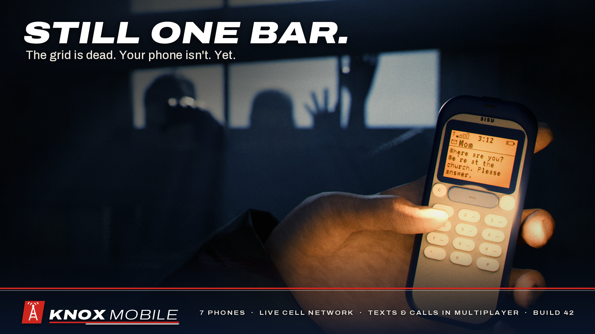
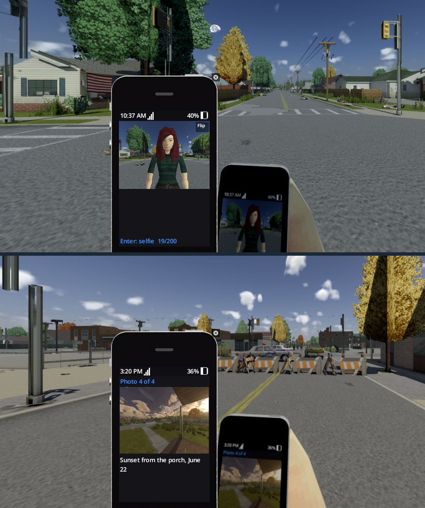
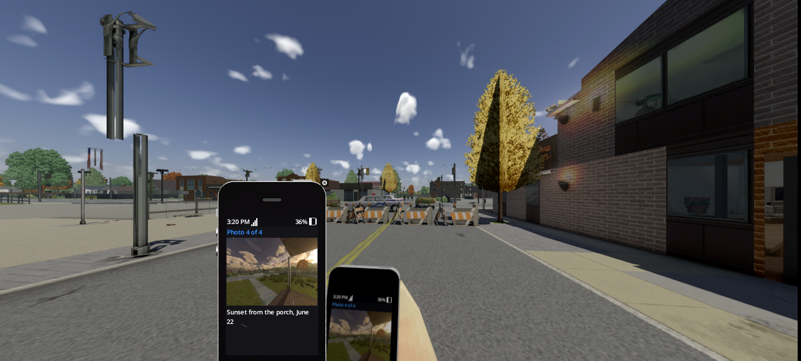
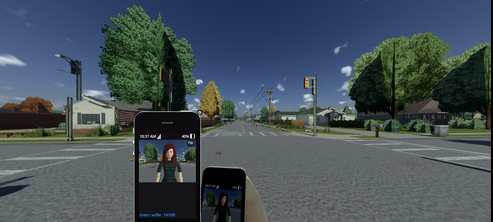
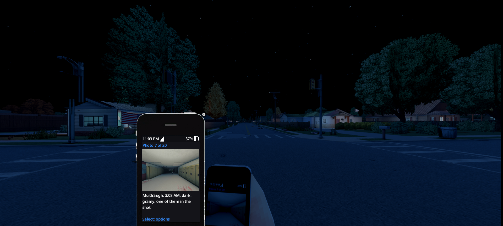
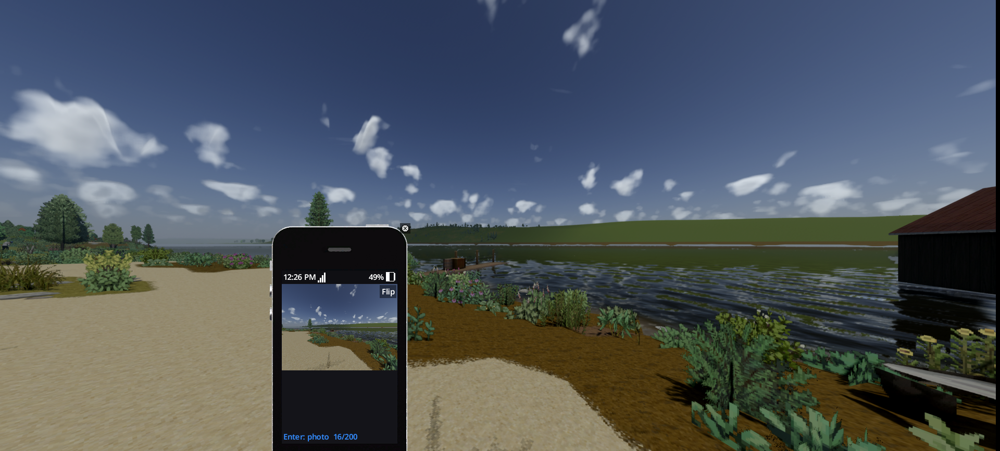
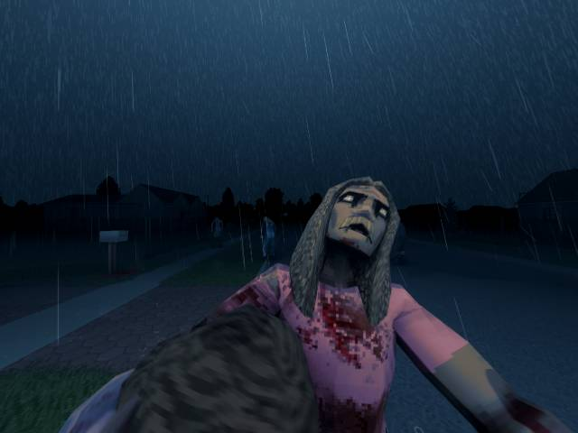
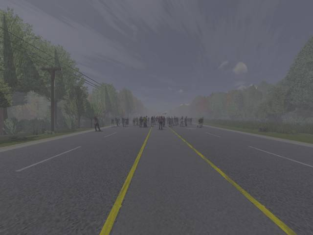
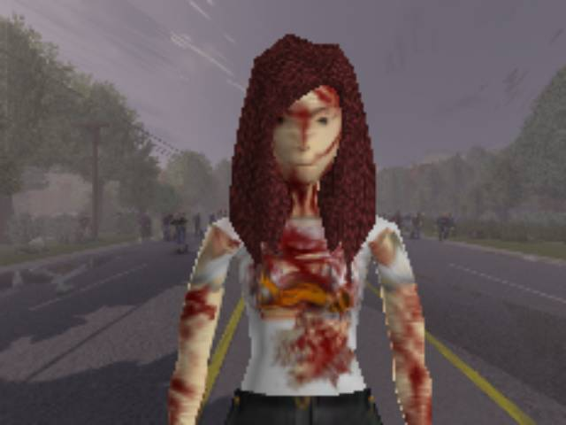
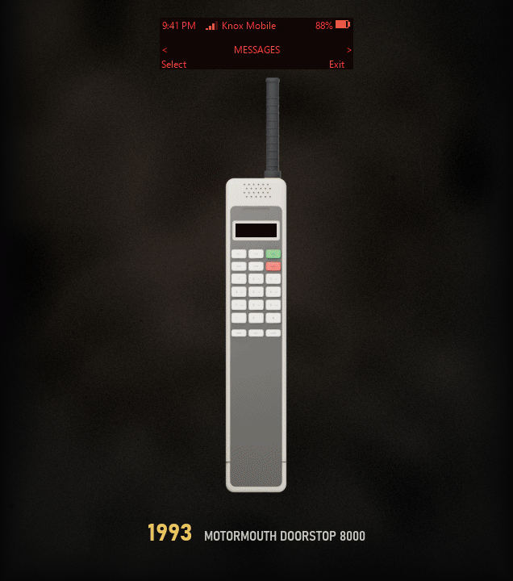

# Knox Mobile: Phones, Calls & Camera for Project Zomboid (Build 42)



**Knox Mobile** is a phone mod for Project Zomboid **Build 42 (42.21+)**, single player and multiplayer, made for
first person with Project Viewpoint. Seven phones from 1993 to 2013, calls and texts between players, a real camera,
and a cell network that dies with the grid.

- **Steam Workshop:** https://steamcommunity.com/sharedfiles/filedetails/?id=3818422092 (Mod ID `KnoxMobile`)
- **Everything for first person in one click:** https://steamcommunity.com/sharedfiles/filedetails/?id=3823860296
- **Version:** 0.1.0, early access (released 2026-10-21). Photos are a work in progress and get the next polish pass.
- **Made by:** Meta

Players should install it from the Steam Workshop. This repository holds the mod exactly as it ships there.

## Features



- **Seven phones, 1993 to 2013, in 19 colors:** Motormouth DoorStop 8000 (1993), Sisu 3301 (2000), Sisu 6606
  "Soapbar" (2003), Sisu 5320 XpressoMusic (2009), Bramble Bend 2580 (2009), PearPhone 4 (2010) and Daebak
  Supernova IV (2013). A "1993 only" sandbox mode keeps the world to the brick phone.
- **Your own number.** Call and text other players, plus group chats. Texts wait until they can be delivered.
- **Family.** Your SIM holds your family's numbers, and they text you through the first weeks. Call them: sometimes
  they pick up.
- **A network that dies with the grid.** 18 cell sites on the map fail after the collapse, rural ones first. A
  generator at a dead site brings it back, and a craftable repeater gives your crew service. Higher floors get more
  bars.
- **Power.** Batteries drain and wear. Each phone has its own plug, with wall, car, solar, hand-crank, AA and
  power-bank chargers.
- **Danger.** Ringing and the camera flash draw zombies. Phones can be dropped, rained on, cracked and repaired
  (rice works). The Alarm app makes a zombie lure.
- **Found phones belong to someone:** their PIN, calls, texts, notes and, on newer phones, their last photos.
- **Apps:** Messages, Phone, Alarm, Snake, Calculator, Map, Photos, Camera, and a Flashlight on the smartphones.
- **First person with Project Viewpoint.** The phone stays in your hand while you walk and look around.
- **With ZombieBuddy:** the phone in your hand shows its live screen, and the Camera takes real photos of exactly
  what you see. Older phones take older pictures (the 2003 Soapbar shoots 160x120), and the PearPhone 4 and
  Supernova IV take selfies.
- **1993 extras:** payphones, a numeric pager, a car phone kit, repair magazines and a Cell Tower Technician
  occupation.
- **Multiplayer:** the server has the final say. Admin broadcasts, classifieds, "find my crew" and SOS.
- **Sandbox:** 50 options on six pages.

| | |
|---|---|
|  |  |
|  |  |

### Shot on the in-game camera

| | | |
|---|---|---|
|  |  |  |



## Requirements and compatibility

- Project Zomboid Build 42.21 or later.
- **Calls between players need voice chat set to Push to talk** (Options, Audio), and voice chat on for servers.
- Optional: [Project Viewpoint](https://steamcommunity.com/sharedfiles/filedetails/?id=3809306528) for first and
  third person.
- Optional: [ZombieBuddy](https://steamcommunity.com/sharedfiles/filedetails/?id=3619862853) for the live screen and
  the camera. Install it the way its page explains, then allow Knox Mobile's Java part when it asks. Without it,
  everything else works.
- Adds its own items and doesn't replace vanilla files.
- Press **0** to open the phone (rebind under Options > Mods). Right-click a phone for everything else.

## What's in this repository

```
Contents/mods/KnoxMobile/
  42/         mod.info, icon, poster, and the Build 42 parts (items, models, textures, sounds, the Java part)
  common/     Lua: shared game logic, server (state, messaging, photo store), client (phone UI, apps, camera)
preview.png   the Workshop thumbnail
media/        screenshots for this page
```

Under the hood: client/server Lua for Build 42's networked multiplayer, a small Java part loaded through ZombieBuddy
for the live screen and the camera, scripted 3D models and textures, and 50 sandbox options. The build tools and
test suite are kept separately.

## Bugs and feedback

Please use the Workshop page's Discussions tab, and include your `console.txt` (in your Zomboid folder).

## License

Copyright (c) 2026 Meta. All rights reserved. The mod is free to play from the Steam Workshop. Please don't
re-upload it or reuse its code or art without permission.
